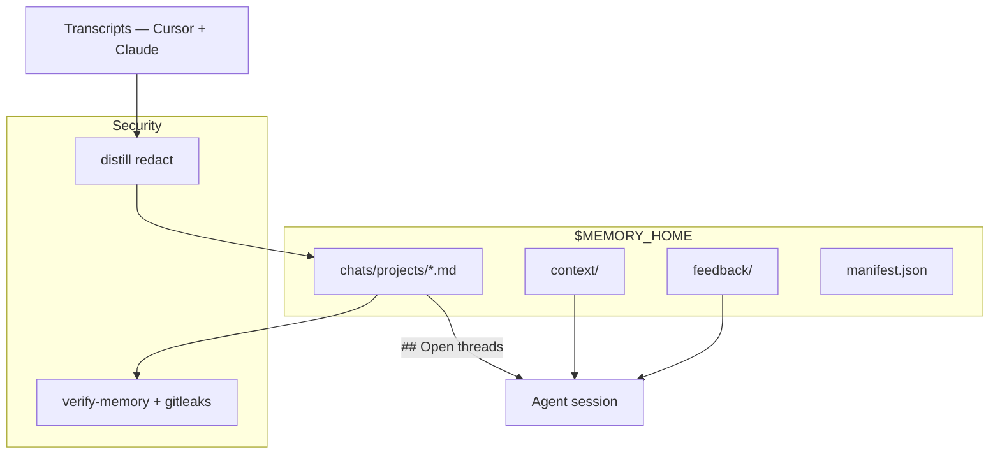

# Agent Memory

## What this is

Coding agents have no memory between sessions. Each new chat starts from scratch, with no knowledge of your projects, past decisions, or where you left off. This plugin gives them persistent memory across three layers:

- **Who you are** — global context, projects, cross-repo rules
- **What worked** — feedback on good and bad agent decisions
- **Where you left off** — distilled chat history with **Open threads** (rolling 30d forward pointer), updated on session boundaries

It runs in **Cursor and Claude Code**, and both share **one hub**: a chat in either environment feeds the same Open threads, decisions and search index. Memory lives in private files outside the plugin bundle and survives updates. Secrets are redacted on every distill.

| Environment | Trigger | Pointer delivery |
|---|---|---|
| **Cursor** | launchd job every 2h (Cursor dropped hook support in June 2026) | `alwaysApply` rule |
| **Claude Code** | hooks: `SessionStart`, `UserPromptSubmit`, `Stop`, `PreCompact`, `SessionEnd` | injected on session start and prompt submit |

Because Claude Code fires real events, memory there survives context-limit compaction and hard session kills — not just a clean exit.

→ [ONBOARDING.md](ONBOARDING.md) · [ARCHITECTURE.md](ARCHITECTURE.md) · [INSTRUCTIONS.md](INSTRUCTIONS.md) · [MIGRATION.md](MIGRATION.md)

## Installation

Both environments read the same hub, so install order does not matter — whichever comes second picks up the existing memory through its own anchor.

### Claude Code

```bash
/plugin marketplace add raphael-batte/cursor-agent-memory
/plugin install agent-memory
```

A local clone works too: `/plugin marketplace add /path/to/repo`. Hooks come with the plugin — your `~/.claude/settings.json` is left alone.

### Cursor

```bash
git clone https://github.com/raphael-batte/cursor-agent-memory.git
cd cursor-agent-memory
bash scripts/install-local.sh
bash scripts/install-periodic-sync.sh   # 2-hourly sync; Cursor has no hooks
```

Then **reload the Cursor window**. `install-local.sh` also links **`~/.cursor/rules/agent-memory-routing.mdc`** (`alwaysApply`) so every chat reads rolling **Open threads** before answering. First open of a project creates the hub and anchor. In chat: **`@agent-memory`** → **set up agent memory**.

Optional manual init:

```bash
bash scripts/init-memory.sh      # idempotent; custom MEMORY_HOME via env
```

Manual refresh anytime: **`@agent-memory`** → **sync with agent memory**.

## How it works

Incremental distill scans new or changed transcripts from every installed environment, redacts secrets, updates the manifest, and writes project summaries. It runs on Claude Code's session events and on Cursor's 2-hourly job.

Both writers take the same `mkdir` lock in the hub and write files atomically. If a hook finds the hub busy it does not stall your session: it records staging and lets the next trigger do the durable write.

**Forward pointer = `## Open threads`** — one bullet per active direction (`**[label]** text · _upd DATE_`), rolling 30-day window, **cross-hub** (a thread in `alpha-hub.md` surfaces from any workspace). Resolve via:

```bash
python3 scripts/memory-routing-hint.py --json .
```

Distill may write **`[auto]`** draft threads from the tail topic segment; agent curates with `memory-pointer.py add-thread` or semantic-merge. **`[auto]` never overwrites curated** threads.

**Search past decisions** without a database: `memory-search.py` scores hub bullets — including evicted `[extracted]` in `chats/archive/*-decisions.md` (lower weight than active `projects/`) — plus optional extract JSON with `--deep` (BM25-lite + synonym expansion from `templates/lang/`).

On first install, `sessionStart` creates hub template files and an anchor config outside the plugin bundle. Full setup — hub path, migrate from backup, first distill scope — runs in chat via the skill wizard.

The skill routes the agent to the right memory layer per task (global context, feedback, or project chat distill). If a thread is vague — drill `[title](uuid)` in **## Recent**.

> **`## Next step` is deprecated** (v0.24+). Existing bodies are passthrough-only; do not write there.

## Where data lives

| Entity | Path | On plugin update |
|--------|------|------------------|
| **Bundle** (Cursor) | `~/.cursor/plugins/local/agent-memory/` | replaced |
| **Bundle** (Claude) | `~/.claude/plugins/…/agent-memory/` | replaced |
| **Anchor** (Cursor) | `~/.cursor/agent-memory/config.json` | survives |
| **Anchor** (Claude) | `~/.claude/agent-memory/config.json` | survives |
| **Hub** — shared | from anchor (default `~/.agent-memory/`) | survives |

Anchors are tiny pointer files; all data lives in the hub. Resolve order for
`MEMORY_HOME`: CLI `--memory-home` → env → this environment's anchor → any other
environment's anchor → default. That last fallback is what lets a second
environment inherit an existing hub rather than starting an empty one beside it.

Runtime state (examples):

- `$MEMORY_HOME/chats/manifest.json` — processed transcript index
- `$MEMORY_HOME/chats/merge-staging/` — distill candidates per chat
- `$MEMORY_HOME/.state/initialized` — first-run sentinel

## Trigger cadence

Internally every environment's events normalize onto the same names.

| Canonical event | Claude Code | Cursor | What happens |
|---|---|---|---|
| `sessionStart` | `SessionStart` | workspace open (via cron) | Hub + anchor init; catch-up distill; Open threads injected |
| `promptSubmit` | `UserPromptSubmit` | — | Open threads injected, debounced 30 min per session |
| `liveDistill` | `Stop` | — | Per-turn distill to staging; never touches the project file |
| `preCompact` | `PreCompact` (`auto` = context limit) | — | Full distill before context is lost |
| `sessionEnd` | `SessionEnd` | — | Distill + `[auto]` Open threads draft |
| — | — | every 2h | `sync-if-cursor-open.sh` distills pending chats |
| Manual | — | `@agent-memory` → **sync with agent memory** | |

Distill runs only when transcripts are new or changed (manifest + file mtime). First bulk sync scope is chosen during setup (e.g. last 90 days).

## Optional env overrides

| Variable | Purpose |
|----------|---------|
| `MEMORY_HOME` | Override hub directory |
| `AGENT_MEMORY_FRAMEWORK` | Override plugin bundle path (advanced) |
| `AGENT_MEMORY_ENV` | Force the environment (`cursor` / `claude`) |
| `AGENT_MEMORY_CURSOR_PROJECTS` | Override Cursor transcript root |
| `AGENT_MEMORY_CLAUDE_PROJECTS` | Override Claude transcript root |
| `AGENT_MEMORY_BOUNDARY_LOG` | Boundary hook log path |
| `AGENT_MEMORY_SESSION_START_LOG` | Session-start hook log path |
| `AGENT_MEMORY_SESSION_LOG` | Session-end hook log path |

## Output format in the hub

**Global context** — `$MEMORY_HOME/context/GLOBAL_CONTEXT.md`  
Who you are, active projects, cross-repo rules, infra notes.

**Feedback** — `$MEMORY_HOME/feedback/`  
What worked (`wins.md`) and what to stop proposing (`fails.md`).

**Chat memory** — `$MEMORY_HOME/chats/projects/<slug>.md`  
Each file includes:

- **`## Open threads`** — forward pointer (curated + optional `[auto]` drafts; cap 7)
- **`## Recent`** — distilled transcript summary
- **`## Decisions`** — curated choices + mechanical `[extracted]` (cap 30; older evicted → `chats/archive/<slug>-decisions.md`)

Curate threads: `python3 scripts/memory-pointer.py add-thread <project> <label> "…"`

## Security

- Secrets are **redacted on distill** before anything is written to the hub
- **`verify-memory`** scans the hub (regex patterns + optional gitleaks)
- CI runs gitleaks on every push to the framework repo
- Never store credentials in memory files — treat the hub as sensitive local data

## Schema



## What's in the bundle

| Area | Contents |
|------|----------|
| Skills | `skills/agent-memory/`, `skills/semantic-merge/` |
| Hooks | `hooks/cursor/hooks.json` — sessionStart, sessionEnd, preCompact, afterFileEdit |
| Scripts | distill, sync, search, verify, doctor, first-run, routing-hint, pointer |
| Templates | hub scaffolds (materialized into `$MEMORY_HOME`) |

**Tests:** `bash tests/run-tests.sh` (250+ checks).

## Common commands

```bash
python3 scripts/memory-routing-hint.py --json .          # rolling Open threads
python3 scripts/memory-pointer.py add-thread myproj widget-ui "on carousel filter swap"
python3 scripts/sync-memory.py --scan-only
python3 scripts/sync-memory.py --days 90 --limit 30
python3 scripts/memory-search.py "deploy ssl" --memory-home "$MEMORY_HOME" --top 8
python3 scripts/memory-search.py "migration" --deep   # extracts within retention_days
python3 scripts/memory-doctor.py --fix
python3 scripts/verify-memory.py --memory-home "$MEMORY_HOME"
bash scripts/verify-hub-upgrade.sh                  # after plugin upgrade
bash scripts/migrate-memory.sh --from /old/hub --to "$MEMORY_HOME"
```

## Legacy cleanup

If you used symlink skills or global `~/.cursor/hooks.json` entries before the plugin — remove them to avoid double distill. See [MIGRATION.md](MIGRATION.md) §3.

## License

[MIT](LICENSE) — [CONTRIBUTING.md](CONTRIBUTING.md): PR → `main`.

Created by [raphael-batte](https://github.com/raphael-batte) · [raphbatte.com](https://raphbatte.com)

**Version:** 0.28.0 — see [VERSIONING.md](VERSIONING.md)
